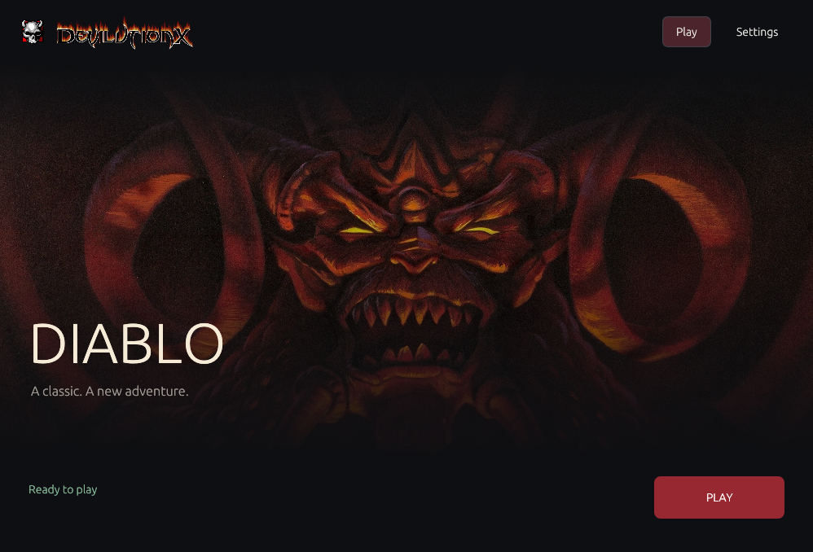
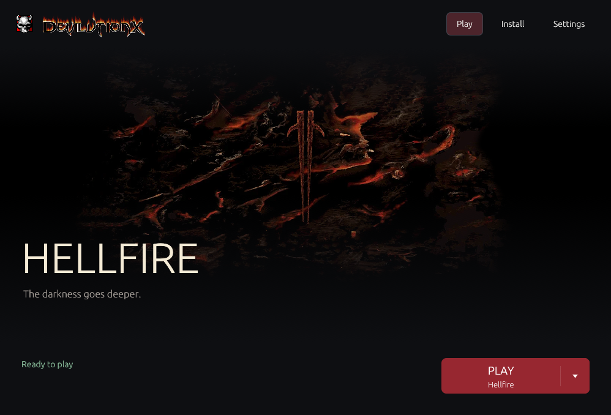
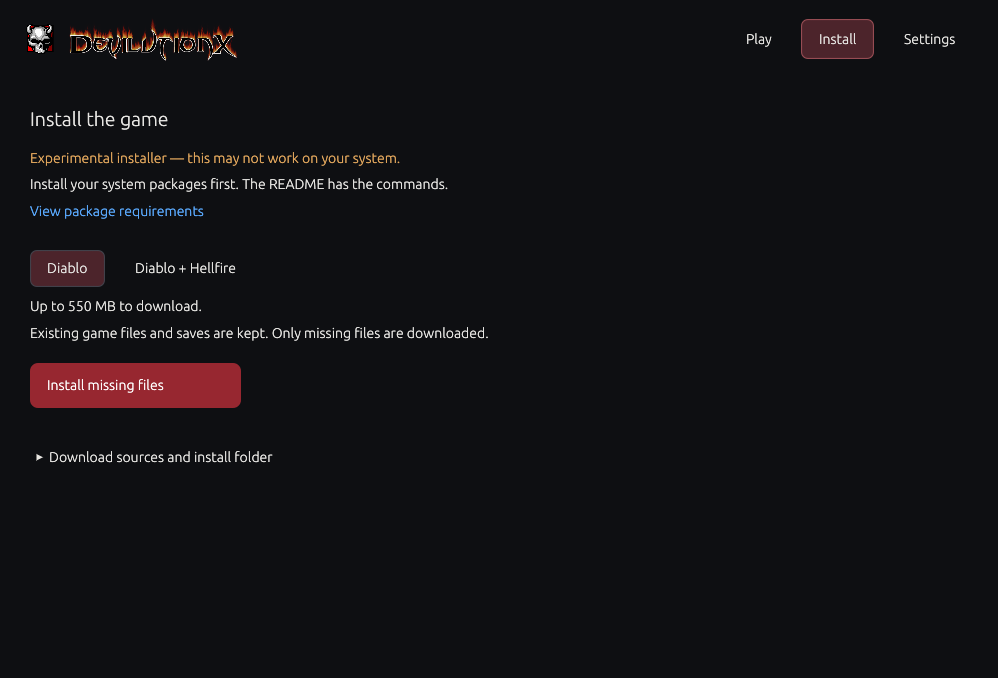
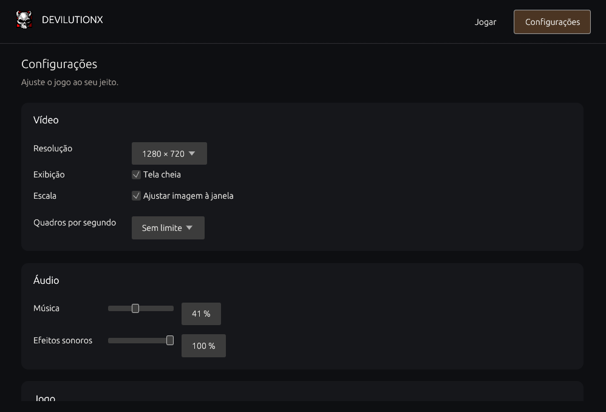

<p align="center">
  
</p>

# Devilution Launcher

Install Diablo I, choose your settings, and return to Tristram — all from one Linux app.

**Experimental installer: this may not work on your system.** Install the packages listed below first. Downloads depend on third-party servers and may fail.



## Install and play

1. Install the [packages for your system](#requirements).
2. Open the launcher and select **Install**.
3. Choose **Diablo** or **Diablo + Hellfire**, then click **Install missing files**.
4. Return to **Play** and use the arrow inside the Play button to choose your game.

The Play button shows the selected game. Switching editions smoothly changes the hero artwork, title, and tagline. Its arrow lets you switch when both games are installed. Existing game files and saves are kept. You can also use your own installation under **Settings → Advanced**.





The installer downloads DevilutionX from its official GitHub release. Diablo and Hellfire data come from the mirrors you can view in the Install screen:

- Diablo: `http://cdn.pvpgn.pro/diablo1/DIABDAT.MPQ`
- Hellfire: `https://hoffmeister.li/downloads/games/diablo_1/`

The launcher repository does not contain the game archives. Downloaded MPQs are checked against their expected size and checksum before installation. Keep a backup of your game files.

## Make it yours

- Adjust graphics, sound, gameplay, keyboard shortcuts, and controller buttons.
- Browse 190 game options, grouped into clear categories.
- Save changes with a backup of your previous settings.
- Install Hellfire later from the **Install** screen.



## Get the launcher

Install [Rust 1.88 or newer](https://rustup.rs) and the build packages in the next section, then run:

```bash
git clone https://github.com/L31T1NH0/devilution-launcher.git
cd devilution-launcher
bash scripts/install-launcher.sh
```

Open **Devilution Launcher** from your applications menu. The launcher installs the game inside your user folders and never runs `sudo` itself.

## Requirements

Automatic game installation currently targets **Linux x86_64** with a normal desktop session and working graphics drivers. Package installation uses your system's administrator password. You do not need Rust to run an already-built launcher; Rust is needed to build it from this repository.

### Linux Mint / Ubuntu / Debian

Game, downloads, and launcher libraries:

```bash
sudo apt update
sudo apt install libsdl2-2.0-0 libsdl2-image-2.0-0 ca-certificates curl python3 xz-utils coreutils libgl1 libegl1 libxkbcommon0 libwayland-client0 libx11-6 libxcursor1 libxi6 libxrandr2
```

Add these to build the launcher:

```bash
sudo apt install git build-essential pkg-config libx11-dev libxi-dev libxrandr-dev libxcursor-dev libxinerama-dev libgl1-mesa-dev libwayland-dev libxkbcommon-dev
```

### Arch Linux / EndeavourOS

Game, downloads, and launcher libraries:

```bash
sudo pacman -S --needed sdl2-compat sdl2_image ca-certificates curl python xz coreutils libglvnd libxkbcommon wayland libx11 libxcursor libxi libxrandr
```

Add these to build the launcher:

```bash
sudo pacman -S --needed git base-devel pkgconf libxinerama
```

### Fedora

Game, downloads, and launcher libraries on current Fedora releases:

```bash
sudo dnf install sdl2-compat SDL2_image ca-certificates curl python3 xz coreutils mesa-libGL mesa-libEGL libxkbcommon wayland-libs libX11 libXcursor libXi libXrandr
```

Add these to build the launcher:

```bash
sudo dnf install git gcc gcc-c++ make pkgconf-pkg-config libX11-devel libXi-devel libXrandr-devel libXcursor-devel libXinerama-devel mesa-libGL-devel wayland-devel libxkbcommon-devel
```

Older Fedora releases may use `SDL2` instead of `sdl2-compat`. Other distributions need equivalent SDL2, SDL2_image, OpenGL/EGL, desktop libraries, curl, Python 3.10+, and GNU coreutils packages. Package commands have not been tested on every distribution.

## Technical notes

- Release builds keep speed optimization (`opt-level = 3`), use Thin LTO and one codegen unit, and strip symbols to reduce binary size. This takes longer to compile.
- Built with Rust and egui. DevilutionX is downloaded separately; the option catalog targets version 1.5.5.
- Fresh downloads need about 550 MB for Diablo, or 725 MB including Hellfire. Extra free space is needed while unpacking. Already installed files are skipped, including compatible MPQs from other editions.
- The engine uses the official HTTPS release. MPQ downloads use pinned SHA-256 checksums. Changed mirror files are rejected rather than installed. Failed or canceled downloads do not replace existing files; completed files are kept for the next attempt.
- The installer uses `curl`, `python3`, and `sha256sum`. It does not install system packages. Canceling or closing the launcher stops the current download.
- Game files normally live in `~/.local/share/diasurgical/devilution`, and the managed engine in `~/.local/share/devilutionx`. XDG data paths are respected for fresh managed installs; existing legacy paths are detected too.
- Settings are backed up as `diablo.ini.launcher.bak`. Unsaved game settings are discarded on close. The game log is under `~/.local/state/devilution-launcher/game.log` or `$XDG_STATE_HOME`.

<details>
<summary>Developer checks</summary>

```bash
cargo run --release --locked
cargo test --release --locked
cargo clippy --release --locked --all-targets -- -D warnings
cargo fmt --check
```

Fourteen offline tests cover settings, edition detection, local HTTP downloads, size/checksum failures, active-download cancellation, unsafe archives, and preservation of files and saves. A separate live test also completed a fresh Diablo + Hellfire install from the configured servers in an isolated folder. The live test used this machine's local SDL libraries; package installation across all distributions has not been verified.

The network test is opt-in because it downloads about 700 MB:

```bash
cargo test --release --locked live_fresh_install_from_configured_sources -- --ignored --nocapture
```

</details>

<details>
<summary>Source layout</summary>

```text
src/
  main.rs       App entry point
  app.rs        App state and process coordination
  game.rs       Game detection and launch commands
  paths.rs      User folders
  config/       Game settings and option catalog
  installer/    Downloads, engine setup, MPQ files, and worker lifecycle
  ui/           Screens, theme, and shared widgets
scripts/        Launcher installation script
config/         Default option data
assets/         Images and screenshots
```

The interface starts jobs and displays progress; installation modules do not depend on egui. Game archives stay outside the repository.

</details>

[Option reference](config/README.md) · [Image credits](assets/SOURCES.md) · [SDL installation guide](https://wiki.libsdl.org/SDL2/Installation) · [Arch SDL packages](https://archlinux.org/packages/extra/x86_64/sdl2-compat/) · [Fedora SDL packages](https://packages.fedoraproject.org/pkgs/sdl2-compat/sdl2-compat/)

An independent project. Not affiliated with Blizzard Entertainment or the DevilutionX team.
