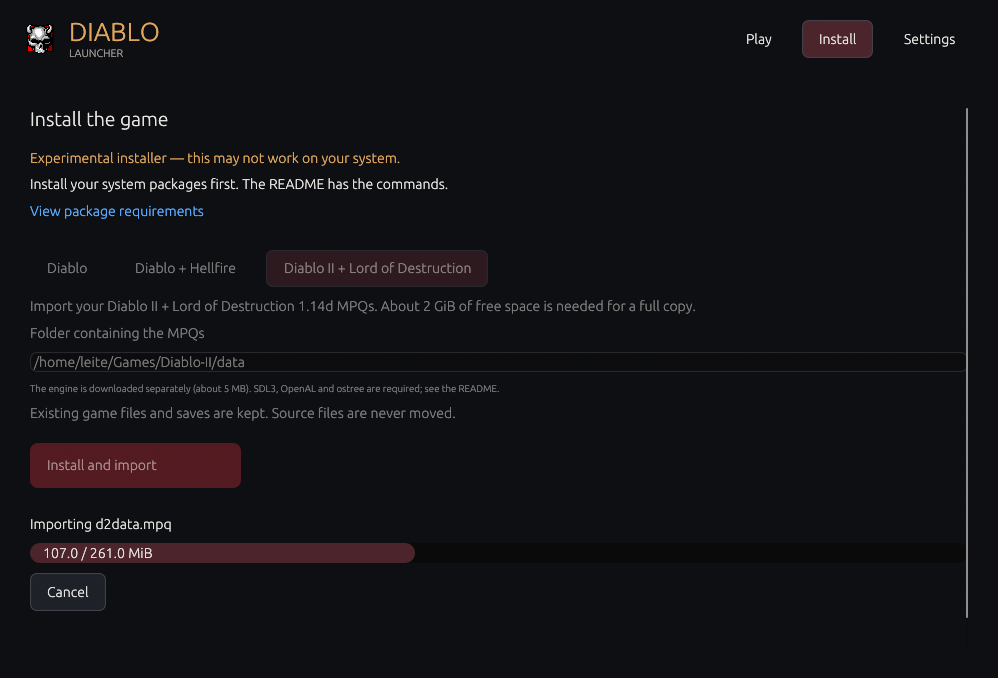
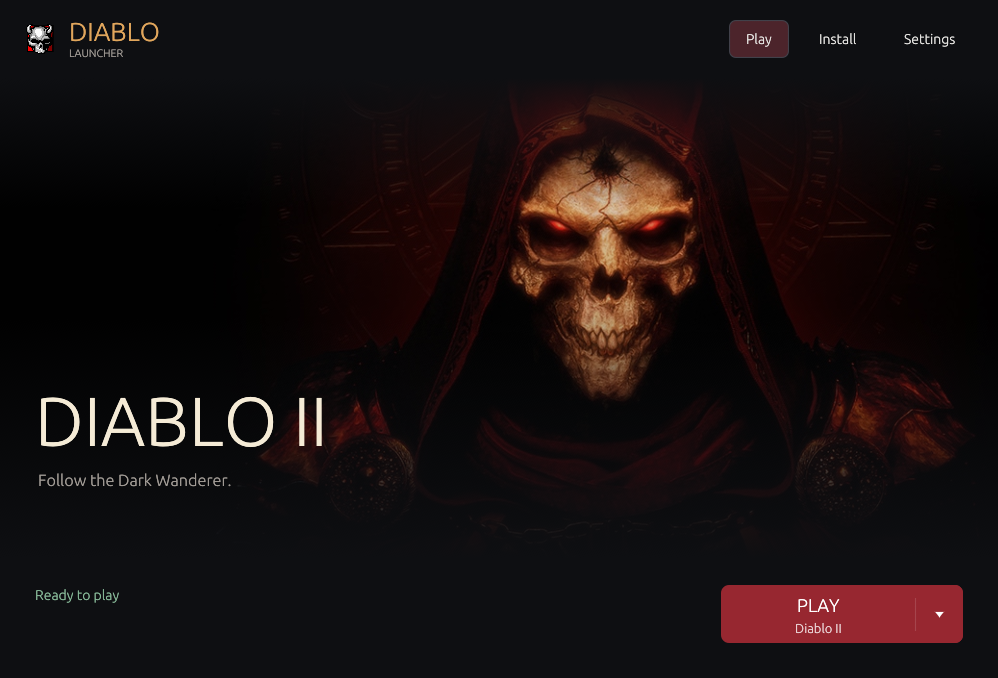
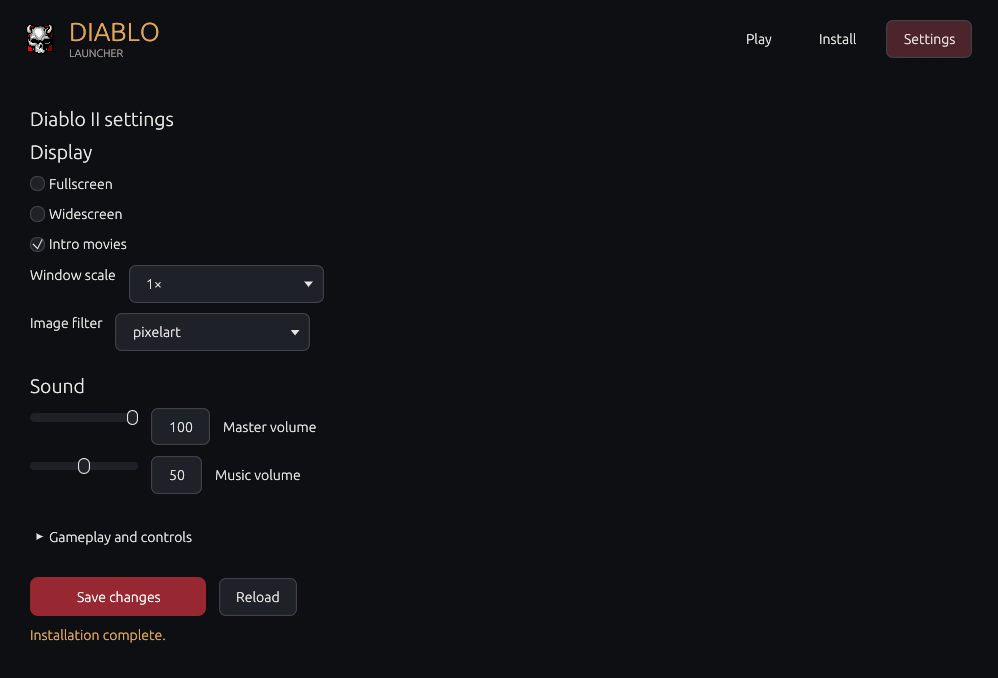

<p align="center">
  
</p>

# Azra Launcher

Play Diablo I, Hellfire, and Diablo II from one Linux app.

**Experimental installer: this may not work on your system.** Install the packages listed below first. Downloads depend on third-party servers and may fail.


## Install and play

Install the [packages for your system](#requirements), then open **Install**.

### Diablo I and Hellfire

Choose **Diablo** or **Diablo + Hellfire**, then click **Install missing files**.

The installer downloads [DevilutionX](https://github.com/diasurgical/DevilutionX). Game data comes from the mirrors shown in the Install screen:

- Diablo: `http://cdn.pvpgn.pro/diablo1/DIABDAT.MPQ`
- Hellfire: `https://hoffmeister.li/downloads/games/diablo_1/`

### Diablo II and Lord of Destruction

Choose **Diablo II + Lord of Destruction**, enter the folder containing your **1.14d MPQs**, and click **Install and import**. The launcher downloads [D2Decomp](https://github.com/psi29a/d2decomped) and copies missing MPQs into its own Diablo II folder. Allow about **2 GiB** for the data copy. Your source files stay where they are.

You need `d2data.mpq`, `d2char.mpq`, `d2sfx.mpq`, `d2speech.mpq`, `d2music.mpq`, `d2video.mpq`, `d2exp.mpq`, `d2xtalk.mpq`, `d2xmusic.mpq`, `d2xvideo.mpq`, and `patch_d2.mpq`. Obtain them from your own [Diablo II and Lord of Destruction installation](https://us.support.blizzard.com/en/article/13867).



**D2Decomp is still unfinished.** Compatibility and gameplay may differ from the original game.

### Choose what to play

Return to **Play** and use the arrow inside the Play button to choose a game. Games without data show **Install**; Hellfire appears after its files are installed. The artwork, title, and tagline change smoothly. Each engine keeps its own settings and saves.



Existing files and saves are kept. Game archives are stored locally and are never included in this repository. You can choose an existing engine or data folder under **Settings → Advanced**.

## Make it yours

- Adjust graphics, sound, gameplay, keyboard shortcuts, and controller buttons.
- Browse 190 DevilutionX options, grouped into clear categories.
- Adjust Diablo II display, sound, and gameplay preferences separately.
- Save changes with a backup of your previous settings.
- Install Hellfire later from the **Install** screen.



## Get the launcher

Download the Linux x86_64 binary from [Releases](https://github.com/L31T1NH0/azra-launcher/releases/latest), install the runtime packages listed below, then run:

```bash
chmod +x diablo-launcher
./diablo-launcher
```

### Build from source

Install [Rust 1.88 or newer](https://rustup.rs) and the build packages in the next section, then run:

```bash
git clone https://github.com/L31T1NH0/azra-launcher.git
cd azra-launcher
bash scripts/install-launcher.sh
```

Open **Diablo Launcher** from your applications menu. The launcher installs the game inside your user folders and never runs `sudo` itself.

## Requirements

Automatic game installation currently targets **Linux x86_64** with a normal desktop session and working graphics drivers. Package installation uses your system's administrator password. You do not need Rust to run an already-built launcher; Rust is needed to build it from this repository.

### Linux Mint / Ubuntu / Debian

Game, downloads, and launcher libraries:

```bash
sudo apt update
sudo apt install libsdl2-2.0-0 libsdl2-image-2.0-0 ca-certificates curl python3 xz-utils coreutils libgl1 libegl1 libxkbcommon0 libwayland-client0 libx11-6 libxcursor1 libxi6 libxrandr2
```

Add these to build the launcher:

```bash
sudo apt install git build-essential pkg-config libx11-dev libxi-dev libxrandr-dev libxcursor-dev libxinerama-dev libgl1-mesa-dev libwayland-dev libxkbcommon-dev
```

### Arch Linux / EndeavourOS

Game, downloads, and launcher libraries:

```bash
sudo pacman -S --needed sdl2-compat sdl2_image ca-certificates curl python xz coreutils libglvnd libxkbcommon wayland libx11 libxcursor libxi libxrandr
```

Add these to build the launcher:

```bash
sudo pacman -S --needed git base-devel pkgconf libxinerama
```

### Fedora

Game, downloads, and launcher libraries on current Fedora releases:

```bash
sudo dnf install sdl2-compat SDL2_image ca-certificates curl python3 xz coreutils mesa-libGL mesa-libEGL libxkbcommon wayland-libs libX11 libXcursor libXi libXrandr
```

Add these to build the launcher:

```bash
sudo dnf install git gcc gcc-c++ make pkgconf-pkg-config libX11-devel libXi-devel libXrandr-devel libXcursor-devel libXinerama-devel mesa-libGL-devel wayland-devel libxkbcommon-devel
```

Older Fedora releases may use `SDL2` instead of `sdl2-compat`. Other distributions need equivalent SDL2, SDL2_image, OpenGL/EGL, desktop libraries, curl, Python 3.10+, and GNU coreutils packages. Package commands have not been tested on every distribution.

### Additional packages for Diablo II

Diablo II needs **SDL3**, OpenAL, zlib, bzip2, curl, and a recent C++ runtime. **ostree** is needed to unpack a fresh D2Decomp download. It is not needed when using an existing compatible `d2d` executable.

Arch Linux / EndeavourOS:

```bash
sudo pacman -S --needed sdl3 openal zlib bzip2 curl gcc-libs ostree
```

Ubuntu 25.04+ / Debian 13+ (where SDL3 packages are available):

```bash
sudo apt install libsdl3-0 libopenal1 zlib1g libbz2-1.0 libcurl4t64 libstdc++6 ostree
```

Fedora:

```bash
sudo dnf install SDL3 openal-soft zlib bzip2-libs libcurl libstdc++ ostree
```

Older Mint, Ubuntu and Debian releases may need a newer SDL3 or C++ runtime than their repositories provide. These package commands have not been tested on every distribution. A compatible manually installed `d2d` can be selected in Advanced settings.

## Technical notes

- Release builds keep speed optimization (`opt-level = 3`), use Thin LTO and one codegen unit, and strip symbols to reduce binary size. This takes longer to compile.
- Built with Rust and egui. Engines are installed separately. The DevilutionX option catalog targets 1.5.5; the Diablo II integration targets D2Decomp 0.9.0.
- Fresh downloads need about 550 MB for Diablo, or 725 MB including Hellfire. Extra free space is needed while unpacking. Already installed files are skipped, including compatible MPQs from other editions.
- DevilutionX uses its official HTTPS release. MPQ downloads use pinned SHA-256 checksums. Changed mirror files are rejected rather than installed. Failed or canceled downloads do not replace existing files; completed files are kept for the next attempt.
- The current D2Decomp executable needs glibc 2.38+ and the GCC 15 C++ runtime. Older systems may need a compatible manual build.
- D2Decomp uses the baseline x86-64 executable from its official Flatpak bundle, verified with a pinned SHA-256 checksum and extracted with ostree. It runs natively and uses system libraries. This avoids the AVX/AVX2 requirement of the upstream Linux tarball.
- The installer uses `curl`, `python3`, and `sha256sum`. It does not install system packages. Canceling or closing the launcher stops the current download.
- Game files normally live in `~/.local/share/diasurgical/devilution`, and the managed engine in `~/.local/share/devilutionx`. XDG data paths are respected for fresh managed installs; existing legacy paths are detected too.
- Diablo II MPQs live in `~/.local/share/diablo-launcher/diablo2/data`; its engine in `~/.local/share/d2decomp/0.9.0`. D2Decomp keeps `d2d.cfg` and `save/` under `~/.config/d2d`. XDG paths are respected.
- Settings are backed up as `diablo.ini.launcher.bak` or `d2d.cfg.launcher.bak`. Unsaved game settings are discarded on close. The game log is under `~/.local/state/diablo-launcher/game.log` or `$XDG_STATE_HOME`; Diablo II has a separate `diablo2.log`.
- Existing launcher preferences stay in the original `devilutionlauncher` storage folder, so renaming the app keeps your settings.

<details>
<summary>Developer checks</summary>

```bash
cargo run --release --locked
cargo test --release --locked
cargo clippy --release --locked --all-targets -- -D warnings
cargo fmt --check
```

Nineteen offline tests cover settings, edition detection, local HTTP downloads, size/checksum failures, active-download cancellation, unsafe archives, and preservation of files and saves, including Diablo II imports, configuration backups, and engine selection. A separate live test also completed a fresh Diablo + Hellfire install from the configured servers in an isolated folder. The live test used this machine's local SDL libraries; package installation across all distributions has not been verified.

The network test is opt-in because it downloads about 700 MB:

```bash
cargo test --release --locked live_fresh_install_from_configured_sources -- --ignored --nocapture
```

</details>

<details>
<summary>Source layout</summary>

```text
src/
  main.rs       App entry point
  app.rs        App state and process coordination
  game.rs       Game selection and DevilutionX launch commands
  diablo2.rs    Diablo II detection, paths and launch commands
  paths.rs      User folders
  config/       Separate engine settings and safe file writes
  installer/    Downloads, engine setup, local imports and worker lifecycle
  ui/           Screens, theme, and shared widgets
scripts/        Launcher installation script
config/         Default option data
assets/         Images and screenshots
```

The interface starts jobs and displays progress; installation modules do not depend on egui. Game archives stay outside the repository.

</details>

[Option reference](config/README.md) · [Image credits](assets/SOURCES.md) · [SDL installation guide](https://wiki.libsdl.org/SDL2/Installation) · [Arch SDL packages](https://archlinux.org/packages/extra/x86_64/sdl2-compat/) · [Fedora SDL packages](https://packages.fedoraproject.org/pkgs/sdl2-compat/sdl2-compat/)

An independent project. Not affiliated with Blizzard Entertainment, the DevilutionX team, or the D2Decomp team.
